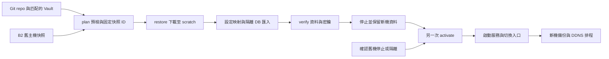

# 替代主機資料庫與設定復原設計

狀態：使用者已確認設計，進入實作計畫撰寫；尚未實作、部署或執行復原。基準版本為 `59023b4`。

## 1. 目標與成功條件

目前主機即使完全無法存取，操作者仍能從獨立保存的 Git repo、加密 Vault、Vault 解鎖方式、B2 憑證與 restic 密碼，在另一台主機復原已備份的資料庫及設定。新機的 SSH 名稱、IP、登入帳號、stack_root、storage_root 可以與舊機不同。

第一版以 Fedora、systemd、Docker Compose v2、SELinux enforcing 為實測範圍，先驗證 x86_64。其他發行版透過 bootstrap task 擴充；ARM64 必須另驗證所有映像與擴充套件，不宣稱第一版已支援。OS 版本須在實作的 CI／VM 測試矩陣中明列，未測版本在 preflight 報告為不支援。

成功分成三層，報告不得混稱：

1. **資料已還原**：來源快照正確、檔案驗證通過、選定資料庫成功匯入，設定與權限已備妥。
2. **服務已驗證**：資料庫代表性資料、n8n credential 解密、應用必要檢查通過；記錄未測的功能與缺失媒體。
3. **正式接管完成**：確認舊機已停止或被隔離、新機應用啟動、入口及 DNS 切換完成，最後才恢復背景工作與排程。

照片、影片、附件、下載資料及其他未備份資料維持排除。本計畫不新增媒體備份，也不把空白媒體目錄視為已完整復原。Immich 原始照片與 WordPress uploads 等若另有磁碟／副本，未來可掛載到新機，但這次不實作搬移工具。

不包含：OS 安裝、磁碟格式化／分割、VPN／SSH 帳號佈建、跨 PostgreSQL major 升級、應用升級、改網域、自動覆蓋非空正式環境、跨主機雙向同步。

## 2. 已有能力與實際缺口

| 現況 | 對設計的影響 |
|---|---|
| `backup_runner.py restore` 只還原至 protected scratch，已含 restic `--verify` | 保留現有用途，不改成覆蓋正式資料的命令 |
| 快照選取綁定 config.host、job tag、舊 staging path | 新機不能用自己的 hostname／state_root 篩選舊機快照 |
| `manifest.json` 沒有 schema version；PG 有版本／角色／extensions／image，其他來源資訊有限 | 定義 version 2，並提供明確的 legacy adapter |
| 備份有 rendered Compose，但部分 image 為 mutable tags | 不直接執行快照 Compose；補記 resolved image digest 與部署版本 |
| `common/tasks/main.yml` 同時處理 Docker、儲存目錄及 DDNS cron | 拆成可選 task 檔，復原只呼叫 bootstrap/storage |
| 各服務 role 同時 render 與 start，Mealie 還會複製 repo prompts | 拆開 prepare/start；先準備基礎檔，再覆蓋快照設定 |
| proxy role 同時建立網路並啟動 Caddy/socket proxies | 復原時只準備正式網路與檔案；驗證不啟動公開入口或 Docker socket proxies |
| PostgreSQL／MariaDB 原始 volume 沒有備份 | 初始化全新資料庫後匯入邏輯 dump，不能把 dump 複製成 data directory |
| 匯出檔統一 root-only | 目的地需要重新套用容器 UID/GID、mode 與 SELinux labels |
| `backup.yml` 會檢查正式來源路徑 | 空白新機不能先執行整個 backup role；需獨立 recovery bootstrap |

現有驗收：B2 備份與 scratch restore、Mealie／Pinchflat SQLite integrity、n8n PG18 匯入（0 workflows／1 credential）、Authentik PG16 匯入（9 users／5 applications／5 providers／20 flows）。這些不是完整應用登入或跨主機演練的證明。

## 3. 方案比較與選擇

| 方案 | 好處 | 限制 |
|---|---|---|
| **Ansible 階段協調＋Python 復原工具（採用）** | 共用現有 Compose／權限定義，集中處理快照、manifest、匯入與驗證；可在 VM 演練 | 需要拆分既有 role tasks，維護復原專用測試 |
| 全部寫成獨立 Python／Shell 工具 | 容易從單一命令啟動 | 會重複 Docker、目錄、SELinux、秘密與服務設定，與 Ansible 容易漂移 |
| 改採 Galaxy restic role | 可重用安裝、快照下載或排程 | 不能直接處理 Authentik、Immich extensions、n8n key、跨路徑映射及接管順序；仍需應用復原層 |

不因本功能更換既有備份方案。共用 restic transport 時保留現有 runner 的外部 CLI 與篩選行為。



## 4. 入口、inventory 與操作介面

新增獨立 `recover.yml`；不 import `site.yml`，不在 `site.yml` 加復原 task。日常 `site.yml`、備份 `backup.yml`、復原 `recover.yml` 各自獨立。

新增 `inventory/recovery.ini.example`，只含 `[recovery_targets]`，不將替代主機預先放進 `[homelab]`。Play 要求 `--limit` 最終只選到一台主機；不跨多台同時執行。正式主機的 inventory 不會因撰寫或執行規劃而變更。

公開設定放在明確指定的 recovery profile，憑證仍從 Vault 注入，不出現在 CLI/history。範例為介面草案，不是目前可執行功能：

```yaml
recover_phase: plan                 # plan | restore | verify | activate
recover_source:
  repository: database
  host: ereshkigal.netbird.cloud    # 舊快照的 hostname，不是 SSH 目的地
  job: database
  staging_path: /var/lib/homelab-backup/staging/database
  snapshot: latest                  # plan 時解析成唯一完整 ID
recover_services: [auth, n8n]        # 每次必填，不默認啟動所有服務
recover_state_root: /var/lib/homelab-recovery
recover_storage_mount: /srv/storage # 已掛載的檔案系統，由 preflight 驗證
storage_root: /srv/storage/homelab
stack_root: /opt/homelab
```

profile 還需提供來源 repository URL、目標支援平台、最低可用磁碟容量、各服務版本／映像對應及 Vault 版本參照。這些是新機設定，不從舊 host_vars 整包繼承；避免意外繼承 `backup_timers_enabled: true`、硬體裝置或舊路徑。共用儲存權限及服務清單可移至非 host-specific 的 vars 檔供兩個入口讀取。

預期操作為兩次主要 sudo session，而非每個服務一串手動命令：

```text
recover.yml --limit replacement -e @recovery-profile.yml -e recover_phase=plan
recover.yml --limit replacement -e @recovery-profile.yml -e recover_phase=restore --ask-become-pass
recover.yml --limit replacement -e @recovery-profile.yml -e recover_phase=verify --ask-become-pass
recover.yml --limit replacement -e @recovery-profile.yml -e recover_phase=activate --ask-become-pass
```

`restore` 自動執行資料層驗證；`verify` 是可重跑的獨立檢查，不必為正常流程多輸一次密碼。實作時依新機 sudo 設定，`plan` 若需讀受保護狀態也必須帶 `--ask-become-pass`，不承諾所有 preflight 都能無 sudo 執行。

## 5. 階段與資料流

### plan：可審閱的預檢

- 檢查目標 SSH identity、OS／架構、Docker／restic 是否存在、儲存 mount 與空間、各目的地是否空白、是否有同名或衝突容器。
- 未安裝的依賴列為 restore 的 bootstrap 工作；plan 不安裝套件、不建立資料庫、不修改來源 repository 或 DNS。
- 若目標缺 restic，來源快照預覽由控制端有 restic 的檢查環境執行；沒有可用工具則明確報告來源預檢未完成，不能假裝已驗證。
- 以 repository＋source host＋completed job tag＋舊 staging path 選取快照；排除 pending。`latest` 只解析一次，之後所有階段固定同一完整 snapshot ID。
- `restic ls` 確認實際 tree layout，定位唯一 manifest，不假設 snapshot.paths 等於 tree 內路徑，不用無限制 `rglob` 選第一個結果。
- 報告選定快照、備份時間、服務依賴、來源／目的地映射、版本與遺失來源／媒體。預檢不足的欄位要標示 unknown 並阻止執行所依賴的階段。
- `--check` 只執行可唯讀完成的檢查；不把 Docker module 的 check mode 結果當作匯入成功。

### restore：資料與設定復原

1. 在空白目標執行 Fedora bootstrap，安裝 Docker／Compose／Python／restic 並準備 SELinux；不部署 DDNS cron，不啟用備份 timer。若既有 Podman／其他套件與 Docker 衝突，預檢列出並停止，不直接沿用 common 中無條件移除套件的行為；套件移除另由操作者處理。
2. 建立 root `0700` recovery run directory 與 `0600` config/state。取得主機級互斥鎖，記錄目標 identity、快照 ID、profile hash 與所選服務。
3. 下載快照到該 run 的 scratch，執行 restic content verification；來源只做快照讀取，允許 restic 所需 lock，不執行 init/tag/forget/prune。
4. 驗證 manifest、必要檔案與 digest、版本／架構、目的地映射、Vault 相容性及容量。全數通過後才寫入正式服務資料目錄。
5. 準備 Compose 與應用基礎檔，不啟動應用。依來源 ID 還原設定與 SQLite，套用目標權限、SELinux labels；不直接覆寫主機 `/etc` 或執行快照腳本。
6. 在 recovery 專用 `internal` Docker network 啟動所選 PostgreSQL／MariaDB。無 published ports、host network、Docker socket、正式 proxy；僅掛載本次新建的資料目錄。
7. 初始化應用角色及資料庫，匯入 dump，執行資料層驗證與 n8n key 解密驗證。所有命令錯誤均中止，不忽略 SQL errors。
8. 停止驗證容器，保留已匯入的新資料目錄供正式容器接續使用；標記 `data_restored`／`verified` 或 `blocked`，輸出不含秘密的報告。

資料不從 restic 直接覆蓋正式路徑：中斷時留在獨立 scratch，避免把半套檔案誤認為復原完成。新資料目錄只允許不存在／空白，或由相同 run 明確建立且 state 可證明擁有；不以 `--force` 清掉未知資料。

### verify：重跑驗證

使用同一 run 與 snapshot ID，不重新匯入已完成的 DB。必要時重新啟動隔離 DB／CLI 容器；輸出資料庫狀態、代表性筆數、設定存在性、權限與 key 解密結果，並區分 metadata-only、未測登入與缺少附件。不能因 container running 就標示應用復原成功。

### activate：獨立的正式接管

- 必須引用同一份驗證報告與快照；選定服務資料均已驗證，所有缺少媒體的服務明確排除啟動或已提供外部媒體。
- 操作者必須確認舊機已停機／被隔離。舊機已故障時不要求能 SSH 進舊機；使用人工確認的外部隔離紀錄。工具不能只憑 ping 不通認定舊機安全停用。
- 受控搬移 DB 容器到正式 Compose 網路，確保 recovery 容器完全停止、同一 volume 不被兩個 DB 同時開啟。相同映像／角色／資料目錄啟動，不在此階段升級版本。
- 順序：正式網路及必要 socket proxies → 各 DB／Redis → Authentik server/worker → 其餘允許啟動的應用 → Caddy。每步有 ready check，失敗即停止後續動作。
- DNS／VPN 路由正式切換第一版由操作手冊控制，不自動管理 registrar／VPN。只有明確核對接管完成後才安裝／啟用新機 DDNS cron；對外切換不在 restore 階段發生。
- 應用啟動可能恢復 n8n workflows、Pinchflat 任務、下載與郵件行為，因此不可在舊機未被隔離前啟動。背景任務不能靠「沒有流量」假設已停用。
- 新機備份目的地、hostname、新 prefix 與 Healthchecks Check 必須獨立設定；不得直接繼承舊 Healthchecks URL，避免兩台 ping 同一 Check 掩蓋停擺。首次備份及監控確認後才啟用新排程。
- 最後把替代主機納入正式 homelab inventory，之後才交回 `site.yml`／`backup.yml` 維護。復原 role 不直接修改控制端 inventory。

## 6. 快照格式與舊快照相容

version 2 manifest 新增：`schema_version: 2`、source host/job、deployment Git revision（含 dirty 狀態）、備份排除範圍、各 source 的 id/kind、artifact 相對路徑與 hash／大小、來源路徑（僅供查核）、服務與映像參照、可用的 registry digest、DB engine/version/database/role/extensions、代表性驗證資訊。

Git revision 與 Vault 版本參照由控制端部署 metadata 提供，不假設伺服器有 repo，也不從伺服器執行 `git rev-parse`。Vault 內容與完整環境變數不寫進 manifest；沿用快照內受加密保護的設定檔，metadata 不額外暴露密鑰。

映像 digest 必須是可從 registry 拉取的參照；只記錄本地 image ID 並不能保證新機可拉取。對於已知版本 tag 無 registry digest、私有或本地建置映像，報告缺少映像封存／取得管道，不能宣稱自動復原可用。不自動把新版 tag 當作舊版的替代品。

原有沒有 schema_version 的快照定義為 legacy v1。根據選定 snapshot 的 tree、既有 manifest、備份 Compose 的白名單欄位，以及人工提供的版本對應 profile，轉成同一 internal recovery model。只以 safe YAML parser 讀取資料，不執行快照中的 Compose／command／DDNS 腳本。

legacy 中缺少可確認的版本、artifact 路徑或必要擴充套件時，列出缺口並阻止相關服務啟動；不回填「目前 repo latest」冒充來源版本。可先完成具備足夠資訊的服務，不能把部分成功標成全服務成功。新功能必須測試目前已存在的 legacy 快照格式，不要求所有歷史備份重新製作。

## 7. 來源 ID 與目的地映射

映射由受版本控制的服務 registry 定義，使用 target inventory 計算目的地；不信任 manifest 指定任意寫入位置。不允許 `..`、symlink、目的地重疊、映射跳出允許 roots、scratch 包含在來源／目的地之內。額外未知 source 保留在 scratch 並列入報告，不自動執行或寫入。

| 來源 | 目標／處理 |
|---|---|
| authentik-db | 新 PG16 → `storage_root/authentik/postgresql` |
| n8n-db | 新 PG18 → `storage_root/n8n/postgres`；注意 PG18 mount 是 `/var/lib/postgresql` |
| immich-db | 相容 PG14＋VectorChord／pgvecto.rs → `storage_root/immich/postgres` |
| wordpress-db | 相容 MariaDB → `storage_root/wordpress/db` |
| mealie-db、pinchflat-db | `mealie/data/mealie.db`、`pinchflat/config/db/pinchflat.db` |
| n8n-key | `n8n/data/config`，與同一快照的 DB 成對 |
| homepage-config、authentik-templates、mealie-prompts、pinchflat-extras | 各服務既定 config／templates／prompts／extras 目錄 |
| wordpress-config/themes/plugins/mu-plugins/htaccess | 先由匹配的 WordPress 映像準備 core，再覆蓋備份的自訂內容；不啟動 WordPress 進行初始化 |
| aria2 config/settings/scripts/filter/session | 對應 `aria2/config`；session 只複製，不呼叫 saveSession 或開始下載 |
| caddy-data/config | 對應 Caddy volume，包含 TLS 私鑰，使用受保護權限 |
| Compose、Caddyfile、ddns | 快照作為版本／秘密相容性參考；使用 target inventory 重新 render，不整份照搬舊 host path |

目標 UID/GID 跟隨所選容器映像的實際使用者，不等於新主機 SSH 帳號。共用唯讀 bind 與 SELinux `:z`／`:Z` 語意維持現有設計；不能對含其他服務資料的整棵 storage_root 任意遞迴 chown。

## 8. 每個服務的匯入及驗收

| 服務 | 自動驗證 | 啟動限制／另外驗收 |
|---|---|---|
| Authentik | pg_restore exit-on-error、users/apps/providers/flows、關聯／必要 schema、secret key 相容性 | 接管後測試登入、OIDC、outpost；restore 階段不啟動 worker 或掛 Docker socket |
| n8n | PG 匯入、workflow/credential 筆數、同快照 key 解密驗證 | 不執行 workflows；外部 binary data 缺失記錄。正式工作只在 activate 後恢復 |
| Immich | 相符 extension libraries/preload、schema、assets/users/albums 代表性資料 | 未提供原始媒體不啟動 Immich app，不以掃描空 library 代替完整復原 |
| WordPress | MariaDB 完整 SQL 匯入、資料表／posts/options 筆數、wp-config DB prefix／密鑰一致性 | uploads 缺失標記部分復原；DEFINER、角色與 grants 必須處理，不忽略匯入錯誤 |
| Mealie | SQLite integrity、recipes/users 筆數、prompts／OIDC 設定 | 圖片附件缺失記錄；正式 OIDC 登入在切換後測試 |
| Pinchflat | SQLite integrity、sources/media profiles 代表性資料、extras | 不因驗證開始排程下載；無 downloads 時不標記內容完整 |
| Homepage | YAML 可解析、必要設定與 secret 檔存在 | 不在驗證期啟用需要正式 Docker socket 的 widget |
| Aria2 | 設定／session 可讀、RPC SECRET 與 Vault 相符 | 下載檔未復原前不啟動，避免 session 自動續傳 |
| Proxy/DDNS | 新路徑 Compose config、Caddy validate、證書／設定可讀、秘密權限 | 不在驗證期發 DNS challenge、公開服務或啟用 DDNS cron |

PostgreSQL：由相符 image 的 pg_restore 使用 `--exit-on-error --no-owner --no-acl` 匯入，目標預先建立正確應用角色與 DB。原始 dump 不含全域 roles／grants，因此必須由 Vault／服務定義重建；不能把測試 superuser 當作正式應用帳號。

MariaDB：以有匯入權限的 bootstrap 帳號執行，不把密碼放 argv；匯入後配置實際 WordPress 帳號／權限並驗證。若 routine／view／event 的 DEFINER 需要原帳號，依已審閱的白名單建立；不以忽略錯誤或任意全文替換 dump 解決。

SQLite：應用停止狀態下安裝已驗證的完整 database.sqlite，不能殘留別次執行的 WAL／SHM；只清理由該 recovery run 建立的檔案。

n8n：在相符版本、受限 internal network 的 CLI container 連接還原 DB，透過官方 credential export/decrypt 功能驗證。明文只允許存在 container tmpfs／記憶體，輸出與錯誤不進 journal，不留下 host 檔案，結果僅記錄成功／失敗及數量；零 credential 時記錄 not-applicable，不能說已測試解密。

筆數以 snapshot 時的 metadata 作準；legacy 可使用先前已知 baseline 或人工審閱結果。與仍在變動的正式 DB 不一致時不能直接判為備份損壞。未做內容比對時報告只宣稱代表性筆數／結構檢查，不宣稱全部資料語意完全相同。

## 9. 憑證、版本與新主機相容

- 災難時不依賴舊機磁碟上的 `/etc/homelab-backup/config.json`。recovery config 由控制端 Vault 產生，與備份的 source path 驗證分開。
- snapshot 內 n8n key 為該份 DB 的必要配對；不能以新機隨機產生的 key 替換。
- Authentik secret key、DB 帳號密碼、WordPress salts／DB 設定等可能與最新 Vault 不同。讀取快照設定的白名單欄位與指定的歷史 Vault 比對，僅輸出欄位名及 match/mismatch。不同時停止相關服務，要求選取匹配的歷史 Vault；不自動旋轉密鑰。
- 以備份時相容的版本復原，不以當前 role defaults 升級舊 DB。先復原、另開變更升級；extensions 版本與 pg_restore 能力在匯入前檢查。
- 第一版保持原網域，避免把 Authentik provider、OIDC callbacks、WordPress URLs 等資料內嵌網址變更混入復原。新主機名稱與 IP 不影響此要求。
- B2 credential／restic password／應用秘密只從 protected config/env/stdin 注入。任務使用 no_log/diff:false；輸出固定錯誤類別，不印 raw SQL、環境、Compose 或 credential 明文。

## 10. 重跑、失敗與回退

run state 為 `planned → downloaded → prepared → imported → verified → activated`，每服務各自記錄，只有可驗證的完成步驟才前進。snapshot ID／profile／target identity 改變時拒絕沿用原 run。

可安全重跑：下載已驗證內容、檢查、render 相同設定、對同 run 未變動且完整的匯入結果執行 verify。不能把 Ansible 一般 idempotency 理解成 SQL dump 可重複灌入。

匯入中斷時標記 failed，不自動重灌。第一版透過清理該 run 擁有的測試 DB container 與新建資料目錄後重新匯入；清理命令先列出清單，要求顯式選擇該 run，未知檔案／正式容器一律拒絕。不存在覆蓋任意舊資料的通用 force 選項。

restore／verify 失敗：保持應用、DDNS、備份 timer 關閉；保留 root-only scratch 與去敏報告供診斷。activate 部分失敗：停止後續啟動，不自動改回 DNS 或重啟舊機。新機若已接收新資料，不能自動回退到舊快照；需人工決定資料處置。

新機 cutover 前舊機仍可服務；最終切換前先停止舊機寫入，製作並驗證最後一份快照，再以該固定 snapshot ID 完成新機復原。舊機突然毀損時只能使用最後成功快照，資料損失取決於備份時間，不保證零損失。

## 11. 程式分工與交付順序

以下是設計層的工作包與驗收界線；逐步測試／實作清單在本規格審閱後另寫 implementation plan。

| 工作包 | 預計檔案／介面 | 獨立驗收 |
|---|---|---|
| A. 可重用的準備與啟動 | `roles/common/tasks/{bootstrap,storage,ddns}.yml`；各 active role 的 `prepare.yml`／`start.yml`，原 main 仍依序呼叫 | 日常部署與 teardown 行為不變；prepare 不啟動容器／DDNS／備份 |
| B. 快照復原契約 | `roles/backup/files/backup_manifest.py`、共享 restic transport、version 2 metadata；保持 runner CLI 相容 | 新舊 fixture 均能讀取；無 digest／版本不被靜默接受；現有備份測試仍通過 |
| C. 獨立跨主機入口 | `recover.yml`、`inventory/recovery.ini.example`、`roles/recovery/{defaults,tasks,templates}` | 只選一台 recovery target，hostname/path 可不同，不執行 site.yml 或完整 backup role |
| D. 快照選取與檔案映射 | `roles/recovery/files/recovery_runner.py`、`recovery_manifest.py`、`recovery_files.py` | 固定 source host/job/path/snapshot；驗證 tree、manifest、路徑、秘密與空目的地 |
| E. 資料庫 adapters 與驗證 | `roles/recovery/files/recovery_databases.py`、`recovery_verify.py`、DB-only Compose template | PG16／18、Immich PG14 extensions、MariaDB、SQLite 真實 round trip，錯誤確實中止 |
| F. state 與正式接管 | `roles/recovery/tasks/activate.yml`、受控 cleanup tasks、去敏報告 | 重跑不重灌；預設無對外行為；先隔離舊機再接管，未知資料不被清除 |
| G. 完整演練與手冊 | `tests/test_recovery_*.py`、`molecule/recovery/`、`docs/recovery.md`、CI | 兩台不同身份／路徑環境，來源主機不可用，仍能完成指定範圍復原 |

先 A/B，再 C/D，再 E/F，最後 G。A/B 必須先保護既有 production 行為；不得為了復原功能破壞目前排程備份。此階段不部署任何 task、不自動切換目前主機，也不新增媒體工作包。

## 12. 測試與最終驗收

### 自動測試

- 單元：不同 source/target host、job/tag/path 篩選、snapshot 前綴歧義與 pending 拒絕；固定 ID 不受新備份影響；legacy/v2 manifest、unknown versions、缺檔／錯 hash；symlink／traversal／目的地重疊；Vault mismatch；已有非空 DB；不當重跑與中斷 state。
- 真實本機 restic：建立含另一主機／另一 job／pending 的 repository，移走來源資料後只依快照復原，選對內容與樹狀路徑，拒絕錯快照。
- 真實資料庫整合：用假資料 fixture 匯出後重建 PG16／PG18／Immich extension PG14／MariaDB／SQLite；測 FK／extensions／roles／grants／DEFINER，不只 pg_restore --list。n8n 正確 key 成功、錯 key 失敗且不洩漏明文。
- Fedora VM／SELinux：新 storage mount 與不同路徑、正確標籤／UID/GID、斷電／重新執行、磁碟不足與依賴缺失。Molecule 容器測試不能替代 SELinux enforcing VM 驗收。
- 阻斷副作用：驗證期沒有公開 port、host networking、Docker socket proxy、DDNS cron、Healthchecks success ping 或 backup timer；嘗試連到假 SMTP／webhook／DNS endpoint，不得成功。DB 網路之外沒有正式應用背景程序。
- 既有全部測試、production lint、site/down/backup/recover syntax、Compose config、gitleaks；拆分 role 後重跑既有 Molecule。復原匯入不以 changed=0 當成唯一正確性標準。

### 最終演練

1. 使用獨立 disposable Fedora VM，與舊機不同 hostname／IP／SSH user／storage_root。
2. 讓演練無法讀取舊機，也不掛原資料磁碟；只提供 repo、匹配 Vault 與 B2，完成 plan／restore／verify。
3. 全服務資料層都需測試，包括尚未驗收的 WordPress／Immich；沒有媒體的應用報告受限並保持停止。
4. 在測試專用網域／網路與假外部服務演練 activate，檢查 Authentik 登入、OIDC 與應用必要路徑。演練 fixture 從備份產生前就使用測試網域／OIDC URLs，不要求工具修改正式備份內嵌網址，也不把正式域名或 DNS 指到 VM。
5. 記錄下載／匯入／驗證時間、磁碟高峰、各服務結果與人工步驟；有量測後才提出 RTO。原主機的排程備份與服務持續不受影響。

第一版交付定義：工具及演練通過上列範圍，操作者無須重新拼裝先前的手動 Docker 匯入指令；仍需明確提供目標／快照及執行正式接管。不能以目前四個 DB 測試結果直接宣布「整台主機完整復原已驗證」。

## 13. 官方依據

- [restic restore 與路徑／原地覆蓋行為](https://restic.readthedocs.io/en/stable/050_restore.html)：host/path 用來挑快照，不是改寫目的地；優先還原 scratch，再做受控映射。
- [PostgreSQL pg_restore](https://www.postgresql.org/docs/current/app-pgrestore.html)：邏輯 archive 匯入、ownership／ACL 選項與錯誤處理；測試需匹配實際 PG major。
- [Immich backup and restore](https://docs.immich.app/administration/backup-and-restore/)：資料庫與原始檔案共同構成復原，沒有照片時不能宣稱完整服務資料。
- [n8n CLI](https://docs.n8n.io/hosting/cli-commands/)：credential decrypted export 會產生明文，因此驗證只能在受限 tmpfs／記憶體內處理，不能列印內容。實作時須核對所選 n8n 版本的實際 CLI flags。
